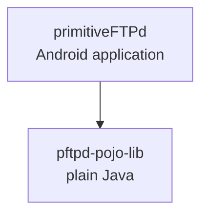
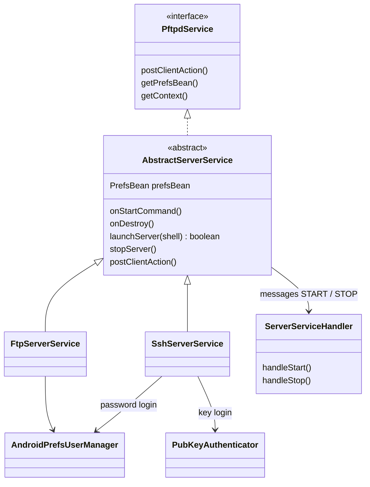

# Components

## Modules

## Packages of the app (`org.primftpd`)

| Package | Responsibility | Most important classes |
|---------|----------------|------------------------|
| *(root)* | Application object and entry points which are not activities. | `PftpdApp` (registers BouncyCastle as first security provider, initialises logging), `BootUpReceiver` (start on boot), `StartStopWidgetProvider` (widget, also target of notification actions) |
| `ui` | Screens. | `MainTabsActivity` (tabs), `PftpdFragment` (main screen: server state, addresses, storage type, permissions, key generation), `QrFragment`, `CleanSpaceFragment`, `ClientActionFragment`, `KeysFingerprintsFragment`, `PubKeyAuthKeysFragment`, `AboutFragment`, `LeanbackActivity` / `LeanbackFragment` (Android TV), `SharedViewModel`, `StartServerAndExitActivity`, `StopServerAndExitActivity` (shortcuts) |
| `prefs` | Preferences. | `LoadPrefsUtil` (keys, defaults, reads `SharedPreferences`), `PrefsBean` (immutable, serializable snapshot handed to the services), `StorageType`, `ServerToStart`, `Logging`, `FtpPrefsFragment` and custom preference widgets (`PortEditTextPreference`, `FtpPassivePortsEditTextPreference`, `EncryptingEditTextPreference`) |
| `services` | The servers as Android services. | `AbstractServerService`, `FtpServerService`, `SshServerService`, `ServerServiceHandler`, `AndroidPrefsUserManager`, `PubKeyAuthenticator`, `PftpdService` (interface the file system classes use), `QuickSettingsService` (tile), `DownloadsService` (download a shared URL) |
| `io` | FTP transport adapted to Android. | `PrimNioListener`, `PrimFtpHandlerAdapter`, `PrimFtpIoSession`, `AndroidIoDataConnectionFactory`, `AndroidIoDataConnection`, `CountingReadableByteChannel`, `CountingWritableByteChannel` |
| `filesystem` | The storage types, each for FTP and for SFTP. | See [storage.md](storage.md) |
| `sftp` | Connects the storage types to the SSH library, which works on `java.nio.file`. | `PftpdFileSystemFactory`, `PftpdFileSystem`, `PftpdFileSystemProvider`, `PftpdFileChannel`, `PftpdSftpSubsystemFactory`, see [ssh-library.md](ssh-library.md) |
| `share` | Receiving data shared by other apps. | `ReceiveQuickShareActivity`, `ReceiveSaveAsActivity`, `AbstractReceiveShareActivity`, `TargetDir`, `QuickShareBean` |
| `remotecontrol` | Control by other apps. | `TaskerReceiverFire`, `TaskerReceiverQuery`, `TaskerEditActionActivity`, `TaskerEditConditionActivity`, `PftpdPowerTogglesPlugin` |
| `events` | Messages on the event bus. | `ClientActionEvent`, `ServerStateChangedEvent`, `ServerInfoRequestEvent`, `ServerInfoResponseEvent`, `DataTransferredEvent` |
| `crypto` | SSH host keys. | `HostKeyAlgorithm` (ed25519, ECDSA 256, RSA 2048 / 4096: generate, store, read) |
| `log` | Logging. | `LogController` (configures logback from the logging preference), `CsvEncoder` |
| `util` | Helpers. | `ServicesStartStopUtil`, `NotificationUtil`, `WakelockUtil`, `Defaults`, `IpAddressProvider`, `RemoteIpChecker`, `KeyFingerprintProvider`, `FilenameUnique`, `EncryptionUtil`, `StringUtils` |
| `filepicker` | Directory picker (vendored NoNonsense-FilePicker with small wrappers). | `ResettingFilePickerActivity` |

## Services in detail

* `AbstractServerService` owns everything both protocols have in common:
  Android life cycle, the timer which stops idle servers, renewal of the wake
  lock during transfers, DNS-SD announcement, posting of client actions.
* `FtpServerService.launchServer()` configures Apache FtpServer: listener
  (`PrimNioListener`), passive ports, IP checks of data connections, user
  manager, file system factory, login limits.
* `SshServerService.launchServer()` configures Apache MINA SSHD: algorithms,
  IP filter, authenticators, SFTP subsystem and SCP command, file system
  factory, host keys.
* `ServerServiceHandler` runs on its own `HandlerThread` per service and does
  the actual start and stop, so the main thread is never blocked. It also
  owns the state shared by both services (root shell, wake lock, number of
  running servers).

## Libraries

| Library | Used for |
|---------|----------|
| Apache FtpServer 1.2.1 (`ftplet-api`, `ftpserver-core`) | FTP protocol |
| Apache MINA core 2.2.5 | Network I/O of the FTP server |
| Apache MINA SSHD 2.19.0 (`sshd-core`, `sshd-sftp`, `sshd-scp`) | SSH, SFTP, SCP, with its own network I/O |
| BouncyCastle 1.83 (`bcprov`, `bcpkix`, `bcutil`) | Key generation, key formats, ed25519 |
| greenrobot EventBus 3.3.1 | Communication between services and UI |
| slf4j 2.0.17 + logback-android 3.0.0 | Logging |
| libsuperuser 1.1.1 | Root shell for storage type "super user" |
| Apache HttpClient 5.6 | Download of shared URLs |
| zxing barcodescanner 1.9.8 | QR code of the server URL |
| AndroidX (appcompat, fragment, preference, documentfile, lifecycle, recyclerview, coordinatorlayout), Material | UI, Storage Access Framework helpers |

## `pftpd-pojo-lib`

| Class | Purpose |
|-------|---------|
| `KeyParser` | Parses lines of `authorized_keys` (RSA, ECDSA, ed25519) into `PublicKey` objects. |
| `LsOutputParser`, `LsOutputBean`, `LsOutputBuilder` | Parse the output of `ls -l` / `ls -ld`. This is how the root storage learns about files. |

Tests: `KeyParserTests`, `LsOutputParserTests` (JUnit 4) with sample key
files and `ls` outputs in `src/test/resources`.

## SSH library

Apache MINA SSHD 2.x (`sshd-core`, `sshd-sftp`, `sshd-scp`) is a dependency,
it is not part of the repository anymore. How the app is connected to it is
described in [ssh-library.md](ssh-library.md).
