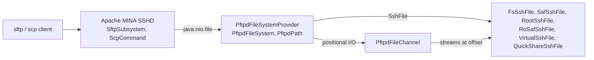

# SSH library: decision and integration

The SFTP / SCP server used a copy of **Apache SSHD 0.14** (2014) inside the
repository. It offered key exchanges based on SHA-1, had no "strict key
exchange" and could not be updated. It has been replaced by
**Apache MINA SSHD 2.19.0** as a normal dependency.

## Which library?

| Candidate | Server | Licence | Maintained | Runs on Android | Verdict |
|-----------|--------|---------|------------|-----------------|---------|
| **Apache MINA SSHD 2.19.0** (June 2026) | yes, incl. SFTP and SCP | Apache 2.0, same as this app | yes, regular releases | Java 8 byte code, no native code. Android is not an official target, but the project documents the needed hooks and has code paths for it. | **chosen** |
| Apache MINA SSHD 3.0 | yes | Apache 2.0 | yes | Only milestone builds (3.0.0-M7) so far, API still changing | later, when released |
| Apache SSHD 0.14 (what was used) | yes | Apache 2.0 | no, 12 years old | yes | replaced |
| Maverick Synergy | yes | LGPL 3 | yes | unknown | other licence than the app, use on Android unknown |
| Dropbear / OpenSSH as native binary | yes | MIT / BSD | yes | needs NDK, own process | can only serve real files: no SAF, no quick share, no virtual folders |
| sshj, JSch, Trilead / ConnectBot sshlib | **no**, client only | – | – | – | not usable |

Why Apache MINA SSHD:

* It is the successor of the library the app already used, same project,
  same licence, concepts carry over.
* It is the only maintained pure Java **server** with SFTP and SCP under a
  licence compatible with the app.
* Its defaults are current: key exchange `sntrup761x25519`, `mlkem768x25519`,
  `curve25519`, ECDH, DH with SHA-2; ciphers `chacha20-poly1305`, AES-CTR,
  AES-GCM; MACs with SHA-2 incl. encrypt-then-MAC; host keys ed25519, ECDSA,
  RSA with SHA-2; strict key exchange.
* ed25519 works with BouncyCastle, which the app ships anyway. The app's own
  signature class (`SignatureEd25519`) is not needed anymore.
* Checked before use: all classes are Java 8 byte code, and they do not call
  methods which only exist in newer Java versions (scan of the byte code for
  the usual trap, covariant `ByteBuffer` methods).

## What had to be bridged

The old library called the app through its own small file API (`SshFile`,
`FileSystemView`). The new one works on `java.nio.file` (`FileSystem`,
`Path`, `FileSystemProvider`). The storage types of the app (plain, root,
SAF, read-only SAF, virtual, quick share) are not real file systems, so they
can not be handed to the library directly.

* `SshFile` and `SshFileSystemView` (package `org.primftpd.filesystem`) are
  the interfaces of the old library, taken over into the app. All storage
  classes implement them **unchanged**. `SshSession` replaces the session
  class of the library there (user name, client address).
* Package `org.primftpd.sftp` is the adapter:

| Class | Role |
|-------|------|
| `PftpdFileSystemFactory` | Creates one file system per SSH session from the view of the configured storage type. |
| `PftpdFileSystem`, `PftpdPath` | `java.nio.file` file system and path, built on helper classes of the library. Home directory of the session is the default directory. Caches resolved files for a second, because one client request makes the library ask several times for the same file and resolving is expensive for SAF and root. |
| `PftpdFileSystemProvider` | Maps open, list, create directory, delete, rename, attributes and access checks to `SshFile`. |
| `PftpdFileChannel` | Positional reads and writes on top of streams which start at an offset: one stream as long as access is sequential, a new one when the position changes. Fills read buffers, reports errors of closing, keeps a modification time which was set while the file was written, records the time of the last transfer. |
| `PftpdFileAttributes` | Attributes of a file in the form `java.nio.file` expects. |
| `PftpdSftpSubsystemFactory` | The SFTP subsystem of the library with the app's file access, plus the extended command `check-file` as prim-sync uses it (the command of the library has another name and reply format). |

Behaviour which the old, patched library had and which is kept by the
adapter: resume at any offset, no implicit truncation for plain storage,
truncation where the protocol asks for it, modification time of `put -p`,
errors when closing an upload, directories are only deleted if empty,
relative paths refer to the start directory.

## Server setup (`SshServerService`)

| Topic | Now |
|-------|-----|
| Network I/O | I/O of the library itself (`Nio2ServiceFactoryFactory`), MINA is only used by the FTP server anymore |
| Algorithms | Defaults of the library, without CBC ciphers and without anything based on SHA-1 or MD5 for key exchange and MAC |
| IP filter | Connections of addresses which do not match the pattern are refused when they are accepted (`IoServiceEventListener`) |
| Password login | unchanged: `AndroidPrefsUserManager` with login limit |
| Public key login | `PubKeyAuthenticator`, compares the encoded keys |
| Host keys | Keys of the app as before (`HostKeyAlgorithm`), passed with `KeyPairProvider.wrap()` |
| Idle timeout, handle limit | Properties of the library (`CoreModuleProperties.IDLE_TIMEOUT`, `SftpModuleProperties.MAX_OPEN_HANDLES_PER_SESSION`) |
| Android | `PftpdApp` tells the library that it runs on Android and where "home" and the working directory are, as described in the library's `docs/android.md` |

## Build

* `gradle/libs.versions.toml`: `sshd = "2.19.0"`, libraries `sshd-core`,
  `sshd-sftp`, `sshd-scp` (`sshd-common` comes with them).
* Module `sshd-core-0.14.0` (268 files) is removed from the repository and
  from `settings.gradle`.

## What is verified and what is not

Verified on a desktop JVM with the real `SshServerService`, see
`code-review/verification.md`: logins, modern algorithms negotiated by
OpenSSH, 5 GiB transfers by SFTP and legacy SCP, resume, time stamps,
directory operations, `check-file`, public key login.

**Not verified:** that the library runs on Android. The points which can
differ there:

| Point | Why it should work | Risk |
|-------|--------------------|------|
| Asynchronous sockets of `java.nio` | Part of Android since 8.0 (API 26), the minimum of the app | medium: the library project does not test on Android |
| `java.nio.file` with an own `FileSystemProvider` | Part of Android since 8.0 | low |
| BouncyCastle for ed25519 and post-quantum key exchange | App installs the full BouncyCastle as first provider | low |
| Classes Android does not have (`javax.management`, JAAS, GSS) | Only referenced in code paths which are not used, or skipped when the library knows it is on Android | low |
| Packaging (duplicate files in the jars) | Licence files are excluded, service files are merged by the build | has to be seen in a Gradle build |

Storage types SAF, root and virtual run through the same adapter but could
only be compiled here, not run. **The first thing to do with this branch is a
Gradle build and a test of SFTP on a phone.**
